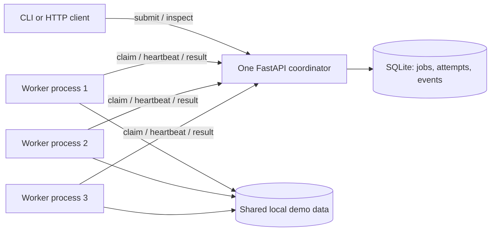

# QueueWorks

QueueWorks is a durable background job queue built with Python, FastAPI, and SQLite. An HTTP coordinator accepts jobs and records their state. Independent worker processes claim jobs over HTTP and run file checksum, image thumbnail, or bounded synthetic handlers.

This is a substantial learning project for understanding transactions, process concurrency, leases, retries, testing, and measurement. Its demonstration runs on one machine. It uses one coordinator and one SQLite database; it is not a replicated database or a consensus system.

## What works

- Validated submission, job inspection, bounded listing, and database readiness endpoints.
- Atomic claims, an expiring lease, a unique token for each attempt, and heartbeats during handler execution.
- Capped exponential retry backoff, configurable attempt limits, and recovery of expired work after a worker crash or coordinator restart.
- Atomic submission idempotency with conflicts for changed content.
- A CLI, generated fixtures, a crash demonstration, process integration tests, and reproducible benchmark tooling.
- Repeatable checksum and thumbnail outputs, including attempt-specific thumbnail temporary files and atomic replacement.

There is no universal exactly-once execution guarantee. A worker can perform work and disappear before the coordinator records its result. A later attempt may execute the handler again. Attempt tokens prevent an old worker from changing the current database state; they do not undo external side effects.

## Quick start

Use Python 3.11 or newer. From a fresh checkout on Linux or macOS:

```sh
python3 -m venv .venv
. .venv/bin/activate
python -m pip install --upgrade pip
python -m pip install -c requirements-lock.txt -e '.[dev]'
queueworks fixtures
queueworks demo --workers 3 --jobs 12
```

On Windows, use PowerShell:

```powershell
py -3.11 -m venv .venv
.\.venv\Scripts\Activate.ps1
python -m pip install --upgrade pip
python -m pip install -c requirements-lock.txt -e ".[dev]"
queueworks fixtures
queueworks demo --workers 3 --jobs 12
```

If local execution policy prevents activation, invoke `.\.venv\Scripts\python.exe` and `.\.venv\Scripts\queueworks.exe` directly. Direct dependency versions are pinned in `pyproject.toml`; `requirements-lock.txt` constrains the complete resolved runtime/development environment used for local verification (Python 3.12.14 on Windows). The runtime dependencies are FastAPI, Uvicorn, HTTPX, and Pillow; pytest and Ruff are development dependencies. SQLite comes with Python. Use the constraint file with installation as shown above. The [verified GitHub Actions run](https://github.com/ChenJY06/queueworks/actions/runs/38368363662) passed installation, tests, and Ruff checks on Linux with Python 3.11 and 3.12.

The demo owns its coordinator and worker subprocesses and cleans them up. It creates an isolated run directory, submits jobs, waits for a worker to own a running job, terminates that worker, and observes lease expiry and recovery. The selection of the crash moment uses observed job state rather than a fixed sleep.

## Run the components yourself

Generate fixtures once, then open separate terminals in the activated environment:

```sh
queueworks fixtures
queueworks serve --host 127.0.0.1 --port 8000
```

```sh
queueworks worker --url http://127.0.0.1:8000
```

Run the worker command in several terminals for several independent processes. Workers share the configured data directory with the coordinator in this single-machine demo, but only the coordinator opens SQLite.

Use `queueworks --help` and the help for each subcommand for all options. Sample submissions and result inspection:

```sh
queueworks submit --kind checksum --payload '{"path":"fixtures/sample.bin"}' --max-attempts 3 --idempotency-key checksum-example --url http://127.0.0.1:8000
queueworks submit --kind thumbnail --payload '{"path":"fixtures/sample.png","width":160,"height":120}' --url http://127.0.0.1:8000
queueworks submit --kind synthetic --payload '{"duration_ms":500,"iterations":0,"fail_until_attempt":0}' --url http://127.0.0.1:8000
queueworks inspect JOB_ID --url http://127.0.0.1:8000
queueworks list --status succeeded --limit 20 --offset 0 --url http://127.0.0.1:8000
```

Replace `JOB_ID` with the ID printed by submission. JSON payloads must retain their double quotes when passed to your shell. PowerShell 7 supports the single-quoted examples above; use the HTTP API if an older shell changes native command arguments.

## HTTP API

FastAPI exposes interactive API documentation at `http://127.0.0.1:8000/docs` while the coordinator runs.

| Method and path | Purpose |
| --- | --- |
| `POST /jobs` | Submit `{kind, payload, max_attempts}`; optionally set `Idempotency-Key`. |
| `GET /jobs/{id}` | Return status, attempt count, timestamps, result or error, attempt history, and durable transition events. |
| `GET /jobs?limit=20&offset=0&status=queued` | Return `items`, `total`, `limit`, and `offset`; status is optional. |
| `GET /health` | Check coordinator and database readiness. |
| `POST /internal/claim` | Claim with `{worker_id}`; receive `{job: null}` or one job with `attempt_token` and `lease_seconds`. |
| `POST /internal/jobs/{id}/heartbeat` | Renew with `{token}`; receive the new lease deadline and duration. |
| `POST /internal/jobs/{id}/complete` | Complete with `{token, result, execution_ms}`. |
| `POST /internal/jobs/{id}/fail` | Fail with `{token, error, execution_ms}`. |

Validation restricts job kinds, payload fields, attempt counts (1–10), pagination (`limit` 1–100, `offset` 0–1,000,000), and input paths. New submission returns HTTP 201; a reused idempotency key with the same normalized submission returns the original job with HTTP 200; changed content returns HTTP 409. Stale worker updates also return HTTP 409, and unknown job IDs return HTTP 404. Public inspection does not expose attempt tokens. Timestamps are UTC Unix seconds, so clients can compute differences without depending on local time zones.

## Architecture



Claims and state changes use short SQLite write transactions. Handlers execute outside transactions. A coordinator reaper checks expired leases at startup, periodically, and around relevant protocol operations. The worker's heartbeat runs separately from its handler, allowing long tasks to renew their leases.

| Setting | Default | Meaning |
| --- | --- | --- |
| `QUEUEWORKS_DB_PATH` | `runtime/queueworks.sqlite3` | Coordinator database file. |
| `QUEUEWORKS_DATA_DIR` | `data` | Root for allowed fixtures and handler output. |
| `QUEUEWORKS_LEASE_SECONDS` | `10` | Duration renewed by valid heartbeats. |
| `QUEUEWORKS_RETRY_BASE_SECONDS` | `0.5` | First retry delay. |
| `QUEUEWORKS_RETRY_CAP_SECONDS` | `30` | Maximum retry delay. |
| `QUEUEWORKS_REAPER_INTERVAL` | `0.25` | Background expiry check interval. |
| `QUEUEWORKS_SQLITE_BUSY_TIMEOUT_MS` | `5000` | Bounded SQLite lock waiting. |
| `QUEUEWORKS_SQLITE_SYNCHRONOUS` | `FULL` | SQLite durability setting. |
| `QUEUEWORKS_WORKER_KEY` | unset | Optional shared key for internal worker endpoints. |

Set the optional worker key consistently for the coordinator and workers; it is transmitted as `X-Worker-Key`. Keep the API on loopback for a local demo. The optional shared key is not a complete production authentication or authorization system.

## Crash and restart demonstration

```sh
queueworks demo --workers 3 --jobs 12 --output-dir runtime/crash-demo
```

The demonstration prints the selected job, its owning worker, the terminated process, the recovered attempt, and terminal results. Evidence distinguishes an expired attempt from a later successful attempt. An accepted job is considered recovered only after it reaches a terminal state. The tool uses deadlines and cleans up all the processes it starts, including when an assertion fails.

A normal worker shutdown stops claims and attempts bounded cleanup of the current attempt. A hard process kill bypasses cleanup. Its lease then expires, and the coordinator either queues a retry or fails the job at its attempt limit. Restarting the coordinator with the same database preserves accepted jobs and attempts; expiry recovery runs again after startup.

## Tests and static checks

```sh
python -m pytest
python -m ruff check .
python -m ruff format --check .
```

Tests cover API validation and pagination, atomic idempotency, controlled-time lease renewal and expiry, retry limits, stale-token rejection, and repeatable handlers. Process integration tests exercise actual HTTP requests and SQLite with independent workers, concurrent claims, coordinator restart, and hard worker termination. Polling is bounded and observes state instead of selecting failure moments with blind sleeps.

The GitHub Actions workflow runs the same commands on Python 3.11 and 3.12. Both matrix jobs passed in the [recorded CI run](https://github.com/ChenJY06/queueworks/actions/runs/38368363662) for implementation commit `e8e4360`. Local verification is recorded below.

## Benchmarks

Run realistic handler work separately from synthetic queue experiments:

```sh
queueworks benchmark --workload realistic --jobs 24 --repetitions 2 --warmup 4 --output-dir benchmarks/runs/realistic
queueworks benchmark --workload synthetic --jobs 24 --repetitions 2 --warmup 4 --duration-ms 100 --iterations 0 --output-dir benchmarks/runs/synthetic
```

To reproduce the combined configuration used for the checked-in local report:

```sh
queueworks benchmark --workload all --workers 1 2 4 --jobs 24 --repetitions 2 --warmup 4 --duration-ms 100 --iterations 0 --lease-seconds 1.5 --output-dir benchmarks/runs/verified
```

Each command compares 1, 2, and 4 workers on identical configured workloads and includes a sequential reference. It records successful completions per second, median and p95 submission-to-completion latency, queue wait, handler execution time, failures, retries, and recovery time after an injected worker crash. Raw CSV and JSON, an environment/configuration record, a compact Markdown report, and SVG plots are saved to the output directory. Large run artifacts are ignored by Git. Memory is not reported because this implementation does not measure aggregate process memory reliably.

The report defines timing boundaries and records workload size, warm-up, repetitions, OS, hardware, and queue configuration. Realistic runs alternate SHA-256 checksums of a 2 MiB generated binary and 128×128 bounding-box thumbnails of a generated 1024×768 image. Synthetic runs use the configured minimum duration and integer-loop iterations. Worker startup and warm-up are excluded from the measured batch; serial HTTP submissions are included. A separate crash probe after each queued batch measures termination to successful recovery and is excluded from batch throughput.

The sequential reference calls the same handlers without HTTP, durable queue writes, worker startup, or lease machinery. It establishes handler cost but is not a durability-equivalent competitor. Small generated fixtures, warm filesystem caches, and sleep-heavy synthetic tasks can make worker-count comparisons misleading; use larger workloads when exploring CPU and disk limits. More workers are not guaranteed to increase throughput.

### Verified local results

Verified locally on 13 October 2026 with Python 3.12.14, Windows 11, and an Intel Core i9-14900HX (32 logical CPUs): **44 tests passed, 1 skipped** in 46.68 seconds. The skip covers POSIX SIGTERM on Windows; the Windows Ctrl+Break graceful-shutdown test passed. Ruff lint and formatting checks passed for all 15 Python files, and `pip check` found no broken requirements. pytest emitted one upstream Starlette/AnyIO deprecation warning. The pre-publication test rerun also passed in 39.84 seconds. GitHub Actions subsequently passed on Linux with Python 3.11 and 3.12. Docker remains unavailable and its configuration unverified.

The three-worker crash demo completed **12/12 accepted jobs**. It killed the observed owner, `worker-3`, while its selected job was running. That job was reclaimed 5.850 seconds after termination and completed after 6.988 seconds, with two attempts and one successful state transition. All demo processes were cleaned up. The [small recorded evidence](benchmarks/results/crash-demo-summary.json) and [verification record](docs/verification.md) document the run. Recovery includes lease expiry, backoff, surviving-worker queue wait, and handler execution; it is not a fixed lease-duration promise.

The completed benchmark used 24 identical jobs per run, four excluded warm-up jobs, and two repetitions per configuration. These values are the **arithmetic means of each repetition's summary**, including its median and p95; they are not pooled percentiles. Times are seconds.

| Workload | Workers | Success/s | Median latency | p95 latency | Median queue wait | Median handler |
| --- | ---: | ---: | ---: | ---: | ---: | ---: |
| checksum/thumbnail | 1 | 17.026 | 0.582 | 0.864 | 0.532 | 0.008 |
| checksum/thumbnail | 2 | 26.575 | 0.276 | 0.348 | 0.190 | 0.008 |
| checksum/thumbnail | 4 | 30.180 | 0.110 | 0.208 | 0.043 | 0.009 |
| synthetic, 100 ms, 0 iterations | 1 | 6.532 | 1.826 | 3.180 | 1.687 | 0.107 |
| synthetic, 100 ms, 0 iterations | 2 | 12.490 | 0.870 | 1.487 | 0.720 | 0.110 |
| synthetic, 100 ms, 0 iterations | 4 | 21.046 | 0.392 | 0.536 | 0.240 | 0.105 |

All **288 measured queue jobs succeeded with zero failures and zero retries**. The 96 sequential reference executions averaged 134.071 success/s for checksum/thumbnail work and 9.094 success/s for synthetic work. The realistic queue was slower than the direct reference at every worker count. Additional workers helped mean queue throughput, but the first realistic four-worker run (25.92 success/s) was slower than its two-worker run (27.21 success/s). Two repetitions and cached small fixtures show variation rather than establishing a general scaling claim. HTTP submission, polling, durable SQLite writes, and process coordination add overhead; these measurements do not separately attribute that cost. Synthetic waiting benefits from concurrent workers and does not prove CPU-work speedup.

Twelve separate crash probes completed all 28 accepted probe jobs. Each selected job had two attempts and one successful state transition; termination-to-success recovery ranged from **2.645 to 2.818 seconds**. Probe jobs and retries are excluded from workload throughput. The standalone 12-job demo has a longer observed recovery time because surviving workers also drain its existing backlog.

Read the [per-run report and plots](benchmarks/results/report.md), [CSV](benchmarks/results/summary.csv), [configuration](benchmarks/results/metadata.json), and [crash summaries](benchmarks/results/crash-summary.json) for exact results and boundaries. SQLite was 3.53.1. Handler durations use `perf_counter` with a reported 100 ns resolution; the wall clock used for latency and queue timestamps reports 15.625 ms resolution on this Python/Windows build, so interpret small differences accordingly. Memory was not measured. Full raw CSV/JSON remain in the ignored `benchmarks/runs/verified/` directory and can be regenerated with the command above.

## Docker Compose

Docker was not available in the implementation environment, so this configuration has not been run locally. Verify it with the commands below before presenting container execution as tested.

```sh
docker compose up --build
```

This starts one coordinator and three workers. The coordinator generates fixtures before serving. Named volumes persist the database and shared data; only the coordinator mounts the database volume. The API is available at `http://127.0.0.1:8000`. All workers use HTTP even inside Compose.

```sh
docker compose exec coordinator queueworks submit --kind checksum --payload '{"path":"fixtures/sample.bin"}'
docker compose exec coordinator queueworks list --limit 20
docker compose down
```

`docker compose down` preserves named volumes. `docker compose down --volumes` intentionally deletes the demonstration database and data. The configuration supplies one coordinator process; do not scale the coordinator into multiple independent database copies.

## Study the implementation

Start with the [learning guide](docs/learning-guide.md), then read the model definitions, storage transactions, HTTP endpoints, worker loop, and handlers in that order. The [design document](docs/design.md) explains invariants and trade-offs; [interview notes](docs/interview-notes.md) connect questions to the actual code. [CV notes](docs/cv-notes.md) contain locally verified project bullets, and the [verification record](docs/verification.md) states exactly what was exercised.

```text
queueworks/
├── src/queueworks/
│   ├── models.py          # Validated submissions and worker messages
│   ├── config.py          # Explicit coordinator configuration
│   ├── store.py           # SQLite transactions, audit, leases, retries
│   ├── api.py             # Public API and internal worker protocol
│   ├── worker.py          # Independent HTTP worker and heartbeat thread
│   ├── handlers.py        # Repeatable handlers and generated fixtures
│   ├── experiments.py     # Process lifecycle, crash demo, benchmark
│   ├── cli.py             # Command-line entry points
│   ├── __main__.py
│   └── __init__.py
├── tests/
│   ├── test_api.py         # Validation, idempotency, leases, transitions
│   ├── test_handlers.py    # Output repeatability and filesystem boundaries
│   ├── test_worker.py      # Bounded shutdown and signal recovery
│   ├── test_process_integration.py # Concurrent claims, crashes, restart
│   └── process_helpers.py
├── docs/                  # Design, learning, interview, CV, verification
├── benchmarks/results/    # Small reviewed local measurement summaries
├── .github/workflows/ci.yml
├── pyproject.toml
├── requirements-lock.txt
├── Dockerfile
├── compose.yaml
├── Makefile
├── .dockerignore
├── .gitignore
└── LICENSE
```

On systems with Make, `make check`, `make demo`, and `make benchmark` are shortcuts for the commands above. On Windows without Make, use those Python and QueueWorks commands directly.

## Limitations

- One coordinator is a single point of availability; there is no replication, leader election, or consensus.
- SQLite serializes writes. WAL permits reader/writer overlap but does not create parallel writers.
- This version uses a shared local data directory and supports only its defined handlers and fixtures.
- Retry scheduling uses coordinator wall time. A large system clock change can alter expiry and eligibility timing.
- Attempt fencing protects coordinator state; external side effects need their own idempotency or fencing strategy.
- Offset pagination is simple and bounded but is not a stable snapshot across concurrent submissions and transitions.
- No production multi-tenant access controls, quotas, priorities, dead-letter workflow, or retention policy are implemented.

## Repository

The destination is [ChenJY06/queueworks](https://github.com/ChenJY06/queueworks). Runtime databases, virtual environments, generated thumbnails, and large benchmark outputs are ignored. The repository includes an MIT license for the original project.

```sh
git status --short
git add src tests docs benchmarks/results .github README.md pyproject.toml requirements-lock.txt Dockerfile compose.yaml Makefile LICENSE .gitignore .dockerignore
git diff --cached --stat
git commit -m "Update QueueWorks"
git push origin main
```

Use these commands for later updates after reviewing the staged changes and running the checks. A fresh clone uses `git clone https://github.com/ChenJY06/queueworks.git`. When connecting an existing checkout without an origin remote, use `git remote add origin https://github.com/ChenJY06/queueworks.git`. Preserve existing remote history and use ordinary pushes; do not force-push.
