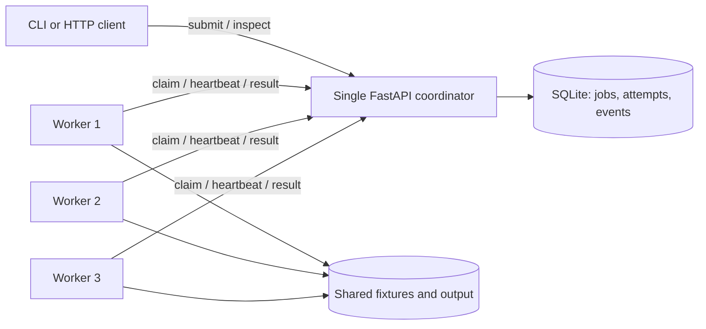

# QueueWorks

A durable background job queue built with Python, FastAPI, and SQLite. One coordinator accepts jobs over HTTP; independent workers claim and execute them without accessing the database.

QueueWorks includes transactional claims, renewable leases, attempt tokens, capped exponential retries, submission idempotency, and durable attempt history. Built-in handlers compute file checksums and image thumbnails. A bounded synthetic handler supports queue experiments.

## Quick start

Requires Python 3.11 or newer. On Linux or macOS:

```sh
git clone https://github.com/ChenJY06/queueworks.git
cd queueworks
python3 -m venv .venv
. .venv/bin/activate
python -m pip install -c requirements-lock.txt -e '.[dev]'
queueworks demo --workers 3 --jobs 12
```

The demo starts a coordinator and three workers, kills an observed job owner, waits for recovery, and cleans up its processes. [Windows setup](docs/usage.md#windows) and [manual operation](docs/usage.md#manual-operation) are documented separately. Dependencies are pinned in `pyproject.toml` and constrained by `requirements-lock.txt`.

To run the components manually, use separate terminals in the installed environment:

```sh
queueworks fixtures
queueworks serve --host 127.0.0.1 --port 8000
```

```sh
queueworks worker --url http://127.0.0.1:8000
```

Submit and inspect a job from another terminal:

```sh
queueworks submit --kind checksum --payload '{"path":"fixtures/sample.bin"}' --idempotency-key checksum-example
queueworks inspect JOB_ID
```

Replace `JOB_ID` with the returned ID. API documentation is available at `http://127.0.0.1:8000/docs`. See the [usage reference](docs/usage.md) for thumbnail jobs, pagination, HTTP messages, configuration, and Docker Compose.

## Architecture



Claims and state changes use short SQLite transactions. Handlers run outside those transactions while a separate heartbeat thread renews the lease. Expired attempts are recovered at startup, periodically, and during worker updates.

Jobs move from `queued` to `running`, then to `succeeded` or `failed`. Failures and lease expiry return a job to `queued` when attempts remain. Execution may repeat after a crash or lost acknowledgement; there is no universal exactly-once guarantee. Attempt tokens reject stale database updates but do not fence external side effects. The [design document](docs/design.md) defines these rules and the SQLite durability trade-offs.

## Crash recovery

```sh
queueworks demo --workers 3 --jobs 12 --output-dir artifacts/demo
```

The failure is injected only after the coordinator reports a running job owned by a live worker. The demo records the terminated process, attempt history, recovery timings, and terminal outcomes in `crash-demo.json`.

In the [recorded run](benchmarks/results/crash-demo-summary.json), all 12 jobs succeeded. The selected job was reclaimed after 5.850 seconds and completed after 6.988 seconds, with two attempts and one successful state transition. That delay includes the backlog on surviving workers. Graceful shutdown cancels and reports interrupted work when possible; a hard kill relies on lease expiry. See [recovery details](docs/design.md#shutdown-and-recovery) and the [verification record](docs/verification.md).

## Measured results

Measured on 13 October 2026 with Python 3.12.14, Windows 11, and an Intel Core i9-14900HX with 32 logical CPUs. Each configuration used 24 jobs, four excluded warm-up jobs, and two repetitions. Values below are arithmetic means of per-run successful completions per second.

| Workload | Sequential reference | 1 worker | 2 workers | 4 workers |
| --- | ---: | ---: | ---: | ---: |
| Alternating checksum/thumbnail | 134.071 | 17.026 | 26.575 | 30.180 |
| Synthetic: 100 ms, 0 iterations | 9.094 | 6.532 | 12.490 | 21.046 |

All 288 measured queue jobs succeeded without failures or retries. Separate crash probes recovered in 2.645–2.818 seconds. The checksum/thumbnail queue was slower than the direct sequential reference, and one four-worker repetition was slower than two workers. The reference omits HTTP, persistence, and leases; synthetic waiting does not establish CPU-work speedup.

Reproduce the measured configuration:

```sh
queueworks benchmark --workload all --workers 1 2 4 --jobs 24 --repetitions 2 --warmup 4 --duration-ms 100 --iterations 0 --lease-seconds 1.5 --output-dir benchmarks/runs/verified
```

The command saves raw CSV/JSON, environment metadata, a report, and SVG plots. The [per-run report](benchmarks/results/report.md) contains median/p95 latency, queue wait, handler time, failures, retries, and crash recovery. [Configuration](benchmarks/results/metadata.json) and [summary CSV](benchmarks/results/summary.csv) preserve the recorded measurements.

The small fixtures benefit from filesystem caching, and two repetitions provide limited evidence about scaling. The recorded wall clock reports 15.625 ms resolution, limiting small latency and queue-time comparisons; handler durations use `perf_counter`. Memory usage was not measured. Full timing boundaries and comparison limits are in the report.

## Tests

```sh
python -m pytest
python -m ruff check .
python -m ruff format --check .
```

The recorded local run passed 44 tests with one platform-specific skip. Tests cover validation, idempotency, lease boundaries, stale updates, retries, repeatable outputs, concurrent workers, coordinator restart, and worker termination. [GitHub Actions](https://github.com/ChenJY06/queueworks/actions/runs/38368363662) also passed on Linux with Python 3.11 and 3.12. Details and the upstream deprecation warning are recorded in [verification](docs/verification.md). `make check` runs pytest and both Ruff checks.

## Limitations

- One coordinator and one local SQLite database; no replication, leader election, or consensus. SQLite serializes writes.
- Shared local fixture storage and a fixed handler set. Retry safety assumes unchanged fixture bytes.
- Bounded retries can still execute work more than once. External side effects need their own idempotency strategy.
- Coordinator wall-clock changes affect lease expiry and retry eligibility. Offset pagination is not a stable snapshot across requests.
- The optional worker key is shared authentication for internal endpoints; multi-tenant authorization, quotas, priorities, and retention policies are not implemented.
- Docker Compose is provided for one coordinator and three workers but remains unverified because Docker was unavailable. See [container operation](docs/usage.md#docker-compose).

## Documentation

- [Usage](docs/usage.md): setup, CLI examples, HTTP protocol, configuration, and containers.
- [Design](docs/design.md): schema, transactions, leases, retries, and filesystem boundaries.
- [Implementation](docs/implementation.md): source map and a job's path through the code.
- [Verification](docs/verification.md): executed checks and crash recovery evidence.

Source is available at [ChenJY06/queueworks](https://github.com/ChenJY06/queueworks) under the [MIT licence](LICENSE). Runtime databases, generated data, virtual environments, and raw benchmark runs are excluded from version control.
