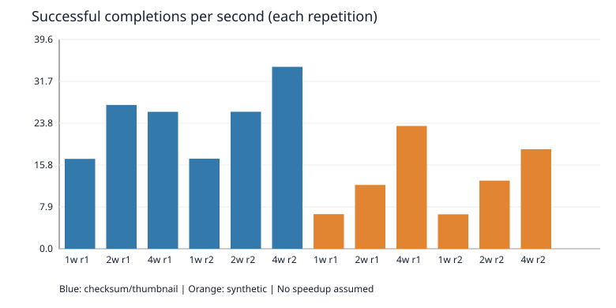
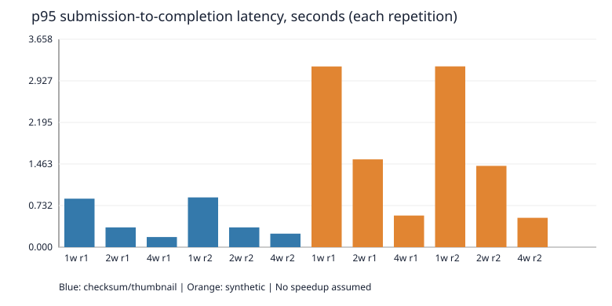

# QueueWorks local benchmark

Measured at 2026-10-13T07:56:32Z on Windows-11-10.0.26300-SP0; CPU: Intel(R) Core(TM) i9-14900HX; logical CPUs: 32; Python: 3.12.14.

Workloads: 24 identical inputs per run; 4 excluded warm-up jobs; 2 repetitions. Synthetic: 100 ms minimum duration with 0 Python integer-loop iterations per job.

Realistic inputs alternate SHA-256 of the generated 2 MiB file and a thumbnail bounded to 128×128 of the generated 1024×768 PNG. Both run through the same handlers in the sequential reference and workers. See metadata.json for the configuration.

| Workload | Mode | Workers | Run | Success/s | Median latency (s) | p95 latency (s) | Median queue (s) | Median handler (s) | Failed | Retries | Crash recovery (s) |
|---|---|---:|---:|---:|---:|---:|---:|---:|---:|---:|---:|
| realistic | sequential | 0 | 1 | 126.56 | 0.1016 | 0.1772 | 0.0938 | 0.0077 | 0 | 0 | — |
| realistic | queue | 1 | 1 | 17.00 | 0.5807 | 0.8528 | 0.5292 | 0.0081 | 0 | 0 | 2.818 |
| realistic | queue | 2 | 1 | 27.21 | 0.2708 | 0.3473 | 0.1640 | 0.0079 | 0 | 0 | 2.763 |
| realistic | queue | 4 | 1 | 25.92 | 0.1029 | 0.1781 | 0.0348 | 0.0079 | 0 | 0 | 2.707 |
| realistic | sequential | 0 | 2 | 141.58 | 0.0866 | 0.1585 | 0.0790 | 0.0070 | 0 | 0 | — |
| realistic | queue | 1 | 2 | 17.05 | 0.5839 | 0.8756 | 0.5354 | 0.0075 | 0 | 0 | 2.744 |
| realistic | queue | 2 | 2 | 25.94 | 0.2813 | 0.3479 | 0.2155 | 0.0091 | 0 | 0 | 2.778 |
| realistic | queue | 4 | 2 | 34.44 | 0.1166 | 0.2375 | 0.0518 | 0.0097 | 0 | 0 | 2.672 |
| synthetic | sequential | 0 | 1 | 9.07 | 1.3733 | 2.5205 | 1.2643 | 0.1091 | 0 | 0 | — |
| synthetic | queue | 1 | 1 | 6.55 | 1.8044 | 3.1794 | 1.6738 | 0.1074 | 0 | 0 | 2.796 |
| synthetic | queue | 2 | 1 | 12.08 | 0.8935 | 1.5441 | 0.7386 | 0.1148 | 0 | 0 | 2.709 |
| synthetic | queue | 4 | 1 | 23.24 | 0.4076 | 0.5563 | 0.2676 | 0.1054 | 0 | 0 | 2.645 |
| synthetic | sequential | 0 | 2 | 9.11 | 1.3824 | 2.5081 | 1.2730 | 0.1095 | 0 | 0 | — |
| synthetic | queue | 1 | 2 | 6.52 | 1.8485 | 3.1811 | 1.6992 | 0.1061 | 0 | 0 | 2.798 |
| synthetic | queue | 2 | 2 | 12.90 | 0.8460 | 1.4299 | 0.7017 | 0.1056 | 0 | 0 | 2.745 |
| synthetic | queue | 4 | 2 | 18.85 | 0.3766 | 0.5159 | 0.2131 | 0.1044 | 0 | 0 | 2.729 |

## Timing and limits

Queue throughput uses the first client's POST start to the last stored terminal timestamp, excluding startup and warm-up. Latency uses each client's POST start to its stored completion timestamp; successful jobs only. Queue residence sums created→first attempt start and previous finish→next start, including retry backoff. Handler time sums worker-measured execution milliseconds; a killed process cannot report its execution duration. Raw rows also retain running lease-occupation time. Handler durations use high-resolution perf_counter; client/coordinator timestamps use this one machine's wall clock. p95 linearly interpolates ordered observations.

The wall clock reports 15.625 ms resolution on this environment. Latency, queue residence and recovery timestamps inherit that granularity. Handler perf_counter reports 100 ns resolution; clock resolution is not a guarantee of measurement accuracy.

Crash recovery is a separate 1100 ms synthetic probe after each measured queue run: kill an observed running job's owner, start one replacement, and measure kill→successful completion. The replacement preserves the configured worker count and is necessary for the one-worker case. Probes do not affect workload throughput, failures, or retry counts. Their full attempts are saved in crash-probes.json.

The sequential reference calls the same handlers directly without HTTP, SQLite, leases, or durability. A batch becomes available at the start, so sequential latency includes waiting behind earlier jobs. Its throughput is a baseline for handler cost, not an equivalent durable queue. Repeated fixtures benefit from OS caching; small local runs are sensitive to scheduling. Submissions are serial HTTP POSTs; SQLite writes serialize; coordinator and client overhead can dominate fast handlers. Synthetic waiting can scale with workers without proving CPU-work speedup. No memory usage is reported because it was not measured reliably.

Observed realistic: sequential mean 134.07 success/s; best queue run 34.44 success/s with 4 workers. These measured values include overhead; they do not imply a guaranteed speedup.

Unfavorable result: realistic, repetition 1, 4 workers achieved 25.92 success/s versus 27.21 with 2. More workers did not always improve throughput in these local runs.

Observed synthetic: sequential mean 9.09 success/s; best queue run 23.24 success/s with 4 workers. These measured values include overhead; they do not imply a guaranteed speedup.
