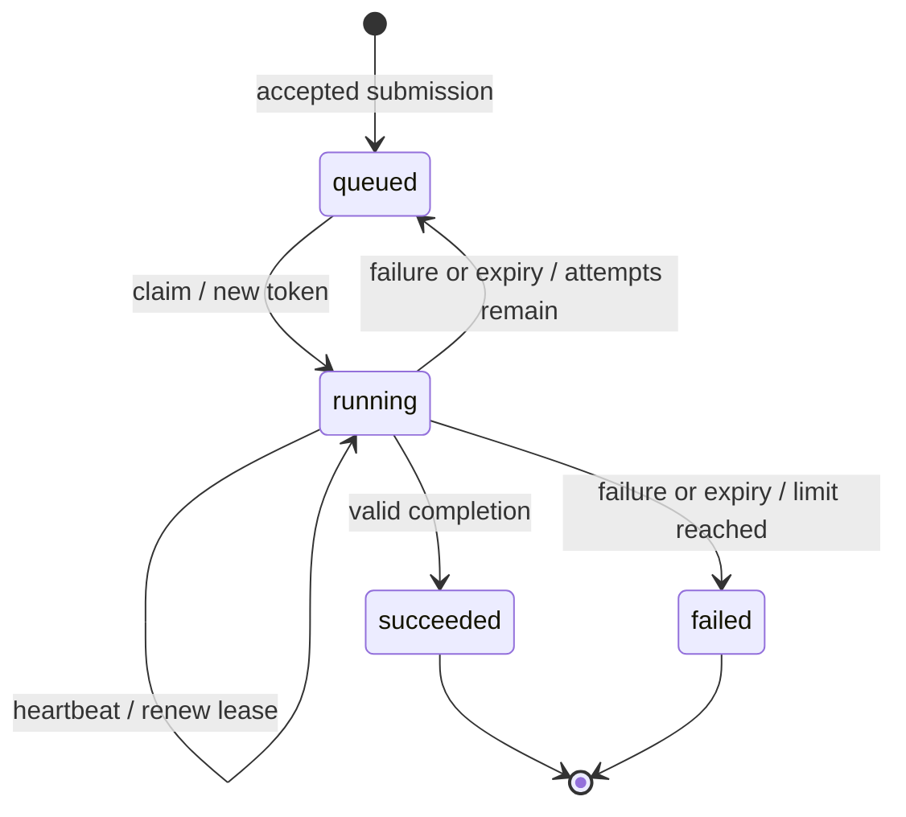

# Design

One FastAPI coordinator owns a local SQLite database. Independent workers communicate with it over HTTP and share the configured fixture/output directory. There are no database replicas or consensus participants.

## Invariants

1. A job has at most one current running attempt.
2. A claim increments the attempt count and assigns a unique token in the same transaction as ownership and lease state.
3. Worker updates require running state, the current token, and an unexpired lease.
4. Job state, attempt outcomes, and transition events commit together.
5. Handlers execute outside database transactions.
6. Terminal jobs cannot accept another completion or return to queued.

## Storage

| Table | Constraints | Stored state |
| --- | --- | --- |
| `jobs` | Job ID primary key; unique optional idempotency key; valid status and bounded attempt count; token and lease present exactly when running. | Normalized submission, canonical content, scheduling timestamps, current ownership, result, and error. |
| `attempts` | `(job_id, attempt_no)` primary key; unique token; job foreign key; valid attempt status. | Worker, queued/eligible snapshots, start/finish times, lease deadline, execution duration, and error. |
| `events` | Increasing sequence primary key; job foreign key. | Timestamp, old/new state, attempt number, and transition reason. |

JSON is stored as `TEXT`; timestamps and durations use `REAL`. Public responses omit tokens, idempotency keys, and canonical content. Read transactions keep the current job, attempts, and events in one snapshot. Heartbeats persist renewed deadlines without adding a state-transition event.

Indexes cover eligible jobs, expired running leases, and per-job event history. `PRAGMA user_version = 1` identifies the schema; unsupported versions fail startup.

## State transitions



Queued jobs can be claimed once `eligible_at <= now`. Running means a lease has been granted, not that the worker is known to be alive. `succeeded` and `failed` are terminal.

Attempt outcomes are recorded separately as `running`, `succeeded`, `failed`, or `expired`. The count increases at claim time, so two attempts do not prove two completed handler executions. An expired attempt followed by a successful retry produces one successful job transition.

## Claims and transactions

`Store.claim()` takes a `BEGIN IMMEDIATE` write reservation before reading candidates. It reaps expired work, selects the earliest eligible job ordered by eligibility, creation time, and ID, then commits the new token, owner, lease, attempt record, and running transition. Simultaneous claim transactions serialize and cannot act on the same queued state.

Submission idempotency uses the same transaction pattern: compare canonical kind, validated payload, and attempt limit, then either return the existing job or insert a new one. The key has a database uniqueness constraint. Conflicting reuse returns HTTP 409. Matching reuse still returns the original job if its fixture has since disappeared.

Each coordinator operation opens its own configured connection. Transactions close before worker execution or HTTP response handling. Empty claims return `job: null`, and workers wait before polling again.

## Leases and stale updates

The coordinator schedules leases using its wall clock. Workers maintain a conservative local deadline with `time.monotonic()`, starting each budget when the request begins. This avoids assuming clock agreement and includes request latency in the budget.

The worker runs the handler and heartbeat loop in separate threads with separate HTTP clients. A heartbeat extends the lease only while the current attempt is still running and unexpired. A lost renewal response leaves the worker's previous local deadline unchanged.

`Store._active()` checks state, token, and `lease_expires_at > now` inside the write transaction. Heartbeat, completion, and failure call it after reaping expired attempts. An update at the exact deadline is stale, even before a periodic reaper tick. Stale updates return HTTP 409; the expiry transition commits before that rejection is raised.

For example, worker A loses contact on attempt 1. After expiry, worker B claims attempt 2 with a different token. A can no longer renew the lease, complete the job, or report a failure. Tokens protect database state; they do not undo side effects already performed by A.

## Retries and delivery semantics

A failed or expired attempt is queued again only while `attempt_count < max_attempts`. Retry eligibility uses:

```text
delay = min(retry_cap_seconds, retry_base_seconds * 2 ** (attempt_count - 1))
eligible_at = now + delay
```

At the attempt limit, failure or expiry makes the job terminally failed. Backoff delays repeated failures but does not fix invalid input or guarantee eventual success.

A worker can finish a handler and disappear before its completion reaches the coordinator. The coordinator may retry that work. Matching submission keys prevent duplicate accepted jobs from client retries; attempt tokens reject obsolete updates. Neither supplies a universal exactly-once execution guarantee.

## Shutdown and recovery

The coordinator reaps expired attempts at startup, periodically, and during claims and worker updates. Restarting with the same database preserves terminal results, queued jobs, and existing leases. Unexpired attempts can still renew or complete; expired ones retry or fail at their limit.

Graceful worker shutdown stops claims, requests cooperative cancellation, and attempts to report interruption as a failure within a cleanup budget. If a handler does not stop, the worker stops claiming rather than overlapping it with another job. CLI handler threads are daemons, allowing process exit. If acknowledgement fails or the process is killed, lease expiry supplies recovery.

Recovery time includes the remaining lease, reaper scheduling, backoff, claim delay, backlog, and retry execution. Short leases recover faster but tolerate less scheduling delay. The crash demo observes a live owner before killing it and checks terminal outcomes; recorded timings are in [verification](verification.md#crash-demonstration).

## Handler and filesystem boundaries

Only checksum, thumbnail, and bounded synthetic payloads are accepted. File paths must be relative to `fixtures/`, exist at first acceptance, and resolve within the data directory. Workers repeat containment checks. No job accepts executable code, shell commands, or URLs.

Checksums are deterministic reads. Thumbnails write an attempt-specific temporary file, then use `os.replace` for the job's stable output path. The destination path is retained rather than replaced with its resolved target, so replacing a symlink does not overwrite its target. Repeated attempts produce identical output only while fixture bytes and payloads remain unchanged.

File replacement and database completion are separate operations. A stale worker may publish a file even though its completion is rejected. Deterministic output makes that safe for these handlers, but other side effects need their own idempotency or fencing. Thumbnail publication does not explicitly fsync the file or directory, so its power-loss durability differs from committed database state.

Synthetic handlers run bounded integer iterations, then wait for any remaining requested duration. `duration_ms` is a minimum measured from handler start; CPU work that exceeds it does not incur an additional full wait. Failure injection applies to the configured initial attempts. [Payload bounds](usage.md#http-api) are shared by HTTP submissions and the benchmark's sequential reference.

## SQLite and durability

- **WAL:** permits reader/writer overlap while retaining one writer. Store the database and live WAL sidecars on a suitable local filesystem.
- **`synchronous=FULL`:** synchronizes commits for stronger power-loss durability than `NORMAL`, at additional write cost. Filesystem, OS, and hardware behavior still affect guarantees.
- **Busy timeout:** bounds waiting for a write reservation. SQLite lock failures become HTTP 503; the worker's lease budget still applies while requests wait.
- **Short transactions:** include scheduling and audit changes together, with no handler execution or network call inside them.
- **Connection settings:** foreign keys, busy timeout, and synchronous mode are set per connection. Startup enables WAL and checks the schema version.

SQLite documents [WAL](https://www.sqlite.org/wal.html), [pragmas](https://www.sqlite.org/pragma.html), and [transaction modes](https://www.sqlite.org/lang_transaction.html). Running additional coordinators or sharing the database across hosts is outside the supported deployment.

## HTTP trust boundary

Internal endpoints can require `X-Worker-Key`. The key authenticates trusted workers as a group, not individual identities or tenants. Worker IDs are audit labels; the attempt token authorizes an active update. Public API authorization and TLS are not implemented. Configuration is in the [usage reference](usage.md#configuration).
