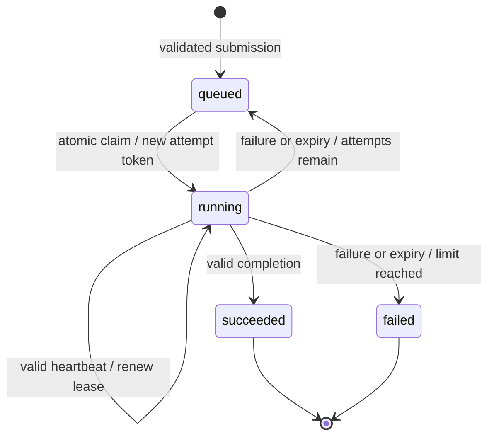

# Design and reliability

QueueWorks coordinates independent worker processes through HTTP. One coordinator owns a single SQLite database, and workers share a local data directory for the supported demonstration handlers. This architecture is a durable queue on one machine, not a replicated system.

## Invariants

1. A job has at most one current running attempt.
2. Claiming increments the attempt count and creates a unique attempt token in the same transaction.
3. A worker update is accepted only for the current running attempt, with its current token and an unexpired lease.
4. Accepted jobs and their committed state changes survive coordinator process restart, subject to SQLite and filesystem durability guarantees.
5. Handler execution never holds a database transaction open.
6. Every attempt is retained for audit and timing, including attempts that expire.

An invariant is a rule that every valid operation must preserve. These rules are more useful than treating a status string alone as proof that work is correct.

## Data model

The `jobs` table stores the durable submission and current scheduling state. Its fields include the job ID, supported handler kind, normalized JSON payload, status, attempt count and limit, creation/update/queue/eligibility timestamps, first start and completion timestamps, current worker and attempt token, current lease expiry, result, and error. The optional submission idempotency key has a unique constraint, and canonical submission content enables matching-versus-conflicting reuse.

The `attempts` table records each attempt number, unique token, worker ID, attempt status, the queued/eligible timestamps copied at claim time, start and finish timestamps, lease expiry, handler execution duration, and error. A `(job_id, attempt_no)` primary key gives each claim one audit record. Job-level success is a single state transition even when several earlier attempts ran.

The `events` table stores durable state transitions with a global sequence, job ID, coordinator timestamp, previous/new status, attempt number, and reason. Submission, claim, handler failure, lease expiry, and completion generate events in the same transaction as their state change. Heartbeats renew lease timestamps without adding a status-transition event.

| Table | Key and constraints | Main stored information |
| --- | --- | --- |
| `jobs` | `id` primary key; unique optional idempotency key; status and attempt-count checks | Submission JSON, canonical content, current status/lease/result, scheduling timestamps. |
| `attempts` | `(job_id, attempt_no)` primary key; unique token; job foreign key; attempt-status check | Owner, scheduling snapshots, lease, start/finish, execution milliseconds, error. |
| `events` | Incrementing `sequence` primary key; job foreign key | Old/new state, reason, attempt number, timestamp. |

SQLite stores JSON as `TEXT` and timestamps/durations as `REAL`. Check constraints require a token and lease expiry precisely when the job is running. Foreign keys are enabled on every connection. `PRAGMA user_version = 1` identifies this initial schema; unsupported schema versions are rejected rather than guessed at. Public job responses include attempts and events but omit canonical submission content, idempotency keys, and attempt tokens.

Timestamps use UTC Unix seconds. The coordinator owns scheduling time. Tests can replace its time source to exercise lease boundaries without waiting for real seconds. The worker measures handler duration with a monotonic clock, which is appropriate for elapsed execution time.

Indexes support selecting eligible queued jobs, finding running jobs with expired leases, and reading a job's events in sequence. Transactions update the current job, attempt history, and events together. Read transactions keep each inspected job and its history in a coherent database snapshot.

## State transitions



`queued` means eligible for future claiming once `eligible_at <= now`. Retrying does not require a separate retrying state. `running` means the coordinator has granted a lease for one attempt, not that it can prove the worker is alive. `succeeded` and `failed` are terminal.

Attempt states record outcomes separately: an attempt may succeed, fail, or expire. An expired attempt followed by success is two executions and one successful job transition. The job's attempt count increases only on a successful claim, not on every poll or heartbeat.

## Atomic claiming and concurrent workers

A claim begins a short `BEGIN IMMEDIATE` write transaction. It reclaims expired work, selects an eligible queued job deterministically, creates the attempt token and audit record, and changes the job to running. It then commits before returning the job to the worker.

SQLite allows one writer at a time. `BEGIN IMMEDIATE` obtains the write reservation before reading candidates, so two simultaneous claim transactions cannot both act on the same queued state. Another writer waits up to the configured busy timeout. This trades serialized, short claim operations for a straightforward invariant. It is intentionally more readable than coordinating execution in a database transaction.

Polling workers may receive no job. Empty claims are normal, and workers wait before polling again rather than busy-spinning. HTTP is the sole worker/coordinator protocol; workers do not open SQLite connections.

## Leases and fencing

A claim grants a lease that expires at a coordinator timestamp. A valid heartbeat extends it. The heartbeat runs separately from the handler, so a long task does not prevent renewal. This also means a process that is alive but cannot reach the coordinator can lose its lease.

Every heartbeat, completion, and failure checks all three conditions: the job is running, the token is the current token, and the lease has not expired. Expiry is strict: reaching the lease deadline invalidates the update, even if the periodic reaper has not run yet. Invalid or obsolete updates receive HTTP 409.

Consider worker A claiming attempt 1 and then losing contact. After expiry, the coordinator schedules another attempt and worker B claims attempt 2. A may later send a result, but its token does not match attempt 2. The database rejects A's result. A cannot renew B's lease or overwrite B's result.

Attempt tokens fence database transitions. They do not fence every possible side effect of a handler. If A wrote to an external service before losing contact, rejecting its completion does not roll back that write. Such handlers would need an idempotency key or fencing mechanism understood by the external service.

## Failure, backoff, and recovery

For an attempt number `n`, retry delay is capped exponential backoff:

```text
delay = min(retry_cap_seconds, retry_base_seconds * 2 ** (n - 1))
eligible_at = now + delay
```

A failed or expired running attempt returns to queued if the attempt count is below `max_attempts`. Otherwise the job becomes failed. No infinite retry loop exists. Backoff reduces immediate repeated failures; it does not make a deterministic bad input become valid.

The reaper runs when the coordinator starts, periodically, and before relevant claim/update operations. On restart, durable running attempts retain their leases. Expired attempts are reclaimed; unexpired attempts remain running until renewed, completed, failed, or expired. The database is the source of truth, so coordinator process memory is not needed to recover accepted jobs.

## Graceful shutdown and hard crashes

On graceful termination, a worker stops claiming work and tries bounded cleanup for its current attempt. It can report an interrupted attempt as failed, letting normal retry policy apply. Cancellation and cleanup are cooperative: an in-progress operation may finish a local side effect before it stops. A shutdown deadline prevents a hung handler or network request from keeping the worker alive indefinitely.

A hard kill bypasses the worker's cleanup code. The job stays running until the lease expires. Recovery latency therefore includes the remaining lease duration, reaper scheduling, retry backoff, a new worker's claim delay, and the retry's handler duration. Shorter leases can improve recovery time but increase false expiry risk under scheduling delays or network pauses.

The crash demo selects a worker only after observing that it owns a running job. Integration tests use the same principle and deadlines. Merely sleeping and killing an arbitrary process would not prove the recovery path was exercised.

## Submission idempotency

Without an idempotency key, two successful submissions create two jobs. With a key, a canonical representation of the handler kind, validated payload, and attempt limit is stored alongside a unique key. The uniqueness check and job insertion occur atomically.

Matching reuse returns the original job even if its state changed after submission. Reusing the key with different content returns HTTP 409. Concurrent requests with the same key cannot both insert a new job. This protects the submission boundary from client retries; it does not remove repeated handler execution after worker failures.

## Handler safety and filesystem boundaries

The accepted handler set is fixed. Payload validation restricts inputs; there is no arbitrary code, command execution, URL fetch, or unrestricted filesystem job. Input paths are resolved within the configured data directory and restricted to the fixtures area. Absolute paths and traversal outside the permitted directory are rejected. Fixtures must already exist when a new file job is accepted. An idempotent replay returns its original job even if that fixture has subsequently disappeared. Workers repeat containment/existence checks rather than trusting a path merely because it arrived over HTTP.

Checksums read supported fixture files and return deterministic digests. Thumbnails use fixed validated dimensions and deterministic input data. Each attempt writes an attempt-specific temporary file and atomically replaces the job's final thumbnail path. A repeated attempt therefore produces the same intended final content and avoids leaving a partially written final image.

Atomic replacement protects file completeness. It is not a distributed transaction with the SQLite completion update. The file may exist even if a worker crashes before reporting success. The next attempt safely repeats the operation. An obsolete attempt may also complete filesystem work after losing its lease; deterministic output makes that acceptable for these built-in samples.

Repeatability assumes the fixture bytes and job payload stay unchanged between attempts. Keep fixtures immutable while jobs use them. Thumbnail publication does not explicitly fsync the file or its directory, so atomic replacement does not promise that the output file survives sudden power loss. The queue's committed result/state and the local output artifact have separate durability boundaries.

Synthetic work is bounded and configurable for experiments, including a controlled number of initial failed attempts. `duration_ms` is a minimum duration from handler start; integer-loop iterations run first, then any remaining duration is waited cooperatively. CPU work that already exceeds the requested duration does not add the full duration again. Sleep-heavy runs demonstrate concurrency and queue overhead. CPU-heavy iterations exercise a different bottleneck; label the workload rather than treating all synthetic runs as representative application work.

## SQLite choices

- **WAL:** writes append to the write-ahead log, allowing readers to coexist with a writer. SQLite still has one writer. The database, WAL, and shared-memory files belong on a local filesystem suitable for SQLite.
- **`synchronous=FULL`:** requests stronger commit durability than `NORMAL`, at the cost of more synchronization work. The filesystem, OS, hardware, and storage device still determine real power-loss guarantees. WAL must be retained with its database while live.
- **Busy timeout:** a bounded wait handles brief lock contention. It cannot make arbitrarily long transactions acceptable or eliminate all busy errors.
- **Short explicit write transactions:** claiming, idempotency, and state transitions use `BEGIN IMMEDIATE`; handler execution and network calls occur outside transactions.
- **Per-operation connections:** coordinator operations configure SQLite connections consistently and avoid sharing a mutable connection across unrelated request threads.

QueueWorks intentionally uses a single coordinator process. Uvicorn replication, network filesystem database sharing, or independent SQLite replicas would require a separately designed deployment and are outside version one.

The underlying behavior is described in SQLite's primary documentation: [WAL concurrency and synchronization](https://www.sqlite.org/wal.html), [synchronous and busy-timeout pragmas](https://www.sqlite.org/pragma.html), and [transaction modes](https://www.sqlite.org/lang_transaction.html).

## HTTP trust boundary

The public API is intended for a local demonstration. Internal endpoints can require the optional `X-Worker-Key` shared secret. Workers must provide the same configured key. This key identifies trusted worker clients as a group; it is not individual worker identity, tenant authorization, TLS, or a production secret-management system.

Worker IDs help audit and demonstrate ownership. A unique token authorizes only the active attempt and is more important than trusting a claimed worker ID.

## Timing and benchmark interpretation

Submission-to-completion latency begins immediately before the client's submission HTTP request and ends at the persisted coordinator completion timestamp. This includes submission overhead. Client and coordinator run on the same machine in these experiments, so their wall timestamps share a clock. Queue waiting time uses persisted creation→first start and previous attempt finish→next start intervals, including eligibility/backoff periods. Handler execution time is the sum of worker-measured handler durations recorded for attempts where those measurements reached the coordinator. A hard-crashed attempt may have no measured execution duration, so an absent duration is not zero CPU usage.

Successful throughput is terminal successes divided by the interval from the first client submission start to the final stored completion in that measured batch. Worker startup and excluded warm-up happen first. Failures and retries accompany throughput; a run that abandons jobs is not a valid throughput improvement. A separate crash probe begins at injected process termination and ends when the selected job is durably succeeded; the probe requires all accepted probe jobs to succeed. The one-worker benchmark starts a replacement after the kill so recovery can occur. Probe jobs do not contribute to the workload's throughput, failures, or retry count.

The sequential reference executes the same handler workload without HTTP, persistence, leases, or workers. Comparing it to the queue shows the total cost of the queue's reliability and process machinery alongside any concurrency benefit. Warm caches, small inputs, worker startup, Python interpreter overhead, and SQLite synchronization can dominate a small run. Results must include configuration and unfavorable outcomes.

## Future work

Useful next experiments include keyset pagination, retention of old attempt records, jittered retry delays, explicit cancellation, larger fixture sets, richer metrics, and bounded queue admission. A move to a server database would address different write concurrency and deployment needs; it would not automatically supply exactly-once side effects or replication correctness.
